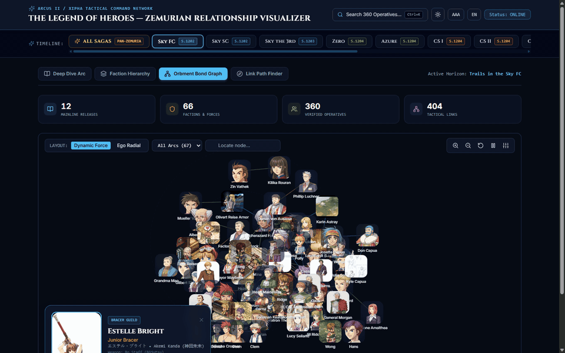
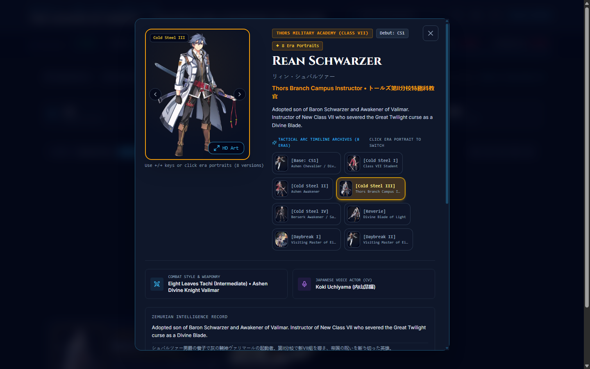
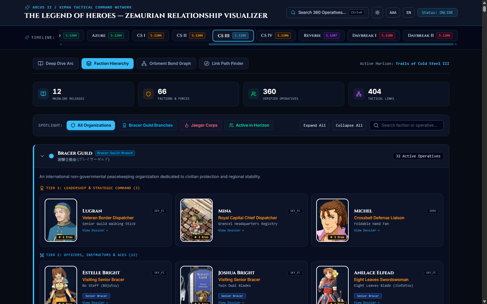
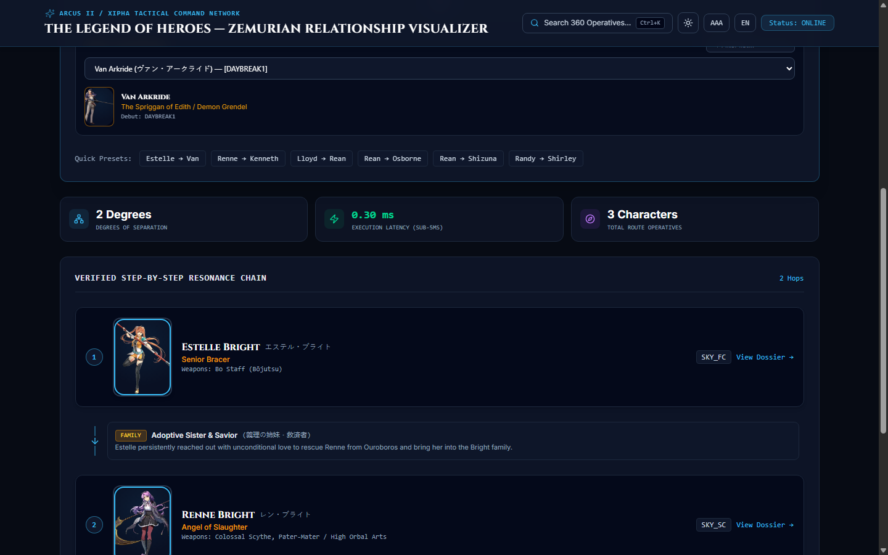
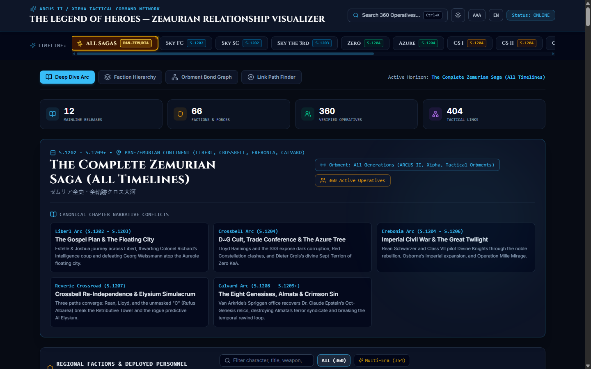

# The Legend of Heroes — Zemurian Relationship Visualizer

An interactive React + TypeScript web application for exploring character relationships, faction hierarchies, and multi-era character dossiers across *The Legend of Heroes* (*Trails* / *Kiseki*) saga using an ARCUS II / XIPHA-inspired interface.

## Live Demo



[Watch full MP4 walkthrough](docs/media/demo.mp4)

## Screenshots

| Orbment Bond Graph | Multi-Era Character Dossier |
| :---: | :---: |
|  |  |

| Faction Hierarchy Tree | Link Path Finder |
| :---: | :---: |
|  |  |

<details>
<summary>Deep Dive Arc View</summary>



</details>

## Features

- **Spoiler-Safe Game Progression Bar**: Select any mainline entry as your active timeline horizon to filter characters, era variants, titles, and relationships without spoiling later games.
- **Orbment Bond Graph**: Interactive relationship network graph with configurable force-physics settings and node inspection.
- **Link Path Finder**: Computes connection paths between any two characters within the active spoiler horizon.
- **Deep Dive Arc View**: Inspects story arcs, active rosters, and relationship dynamics with explicit per-entry spoiler unmasking.
- **Faction Hierarchy Tree**: Browse Zemurian organizations, guilds, military forces, and affiliations by arc and hierarchy.
- **Character Dossiers & Global Search (`Ctrl+K` / `Cmd+K`)**: Search across operatives, Japanese/English names, factions, weapons, and voice actors; inspect multi-era character portraits and metadata.
- **Accessibility & Display Controls**: English / Japanese (`EN` / `JA`) label toggle, Dark / Light theme switch, and WCAG AAA high-contrast mode.

## Tech Stack

- **UI & Runtime**: React 19, TypeScript 5.7, Tailwind CSS v4, Lucide React
- **Validation**: Zod (runtime schema validation for games, factions, characters, and relationships)
- **Build & Test**: Vite 6, Vitest 5

## Getting Started

### Prerequisites

- Node.js 20+ and npm

### Installation & Development

```bash
npm install
npm run dev
```

### Build & Preview

```bash
npm run build
npm run preview
```

### Run Tests

```bash
npm test
```

## Project Structure

- `src/schemas/` — Zod schemas for games, factions, characters, and relationships
- `src/data/` — Regional character rosters, factions, timeline definitions, and relationship datasets
- `src/services/` — Spoiler filtering engine, BFS relationship pathfinder, and local storage persistence
- `src/components/` — Graph, hierarchy tree, deep-dive arc, pathfinder, progression bar, and dossier modal views
- `public/assets/portraits/` — Bundled character portrait assets (`.webp` and `.svg`) and manifest
- `tests/` — Unit, data-fidelity, stress, and E2E test suites

## Copyright & Attribution

This is a **non-commercial fan project** created for educational and community reference purposes.

- *The Legend of Heroes* (*Trails* / *Kiseki* / *Eiyuu Densetsu*), character names, settings, lore, and portrait artwork under `public/assets/portraits/` are the property of **Nihon Falcom Corporation**.
- Character portrait references and lore details are attributed to the community-maintained **Kiseki Wiki** (`kiseki.fandom.com`).
- No copyright infringement is intended; all third-party assets are used under fair-use / non-commercial fan-work principles.

## License

Source code is licensed under the [MIT License](LICENSE). Third-party intellectual property and character assets remain the property of their respective copyright holders.
